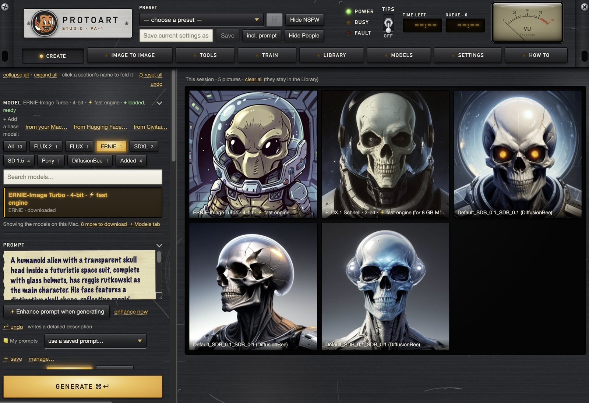
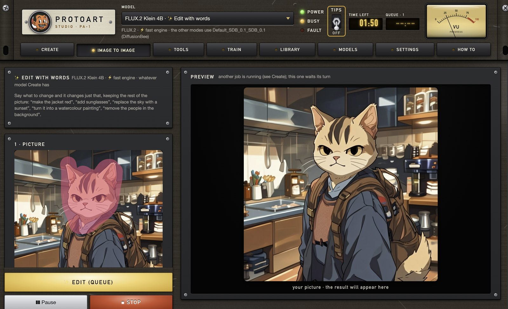
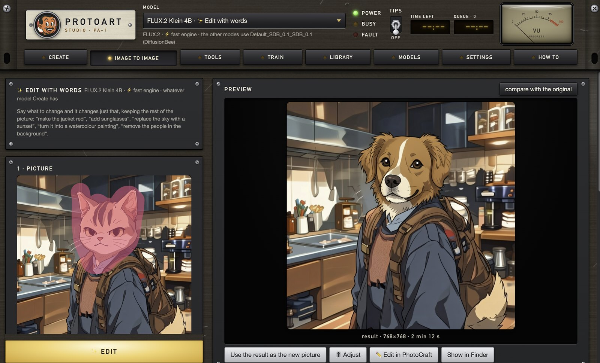
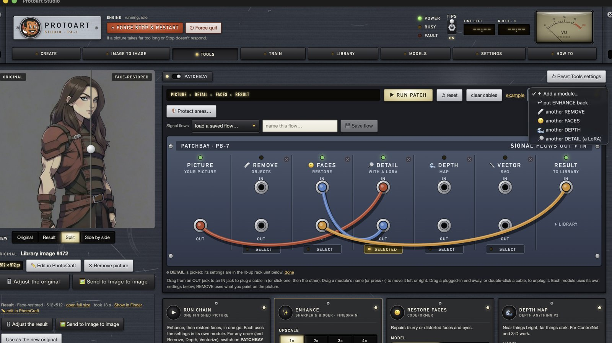
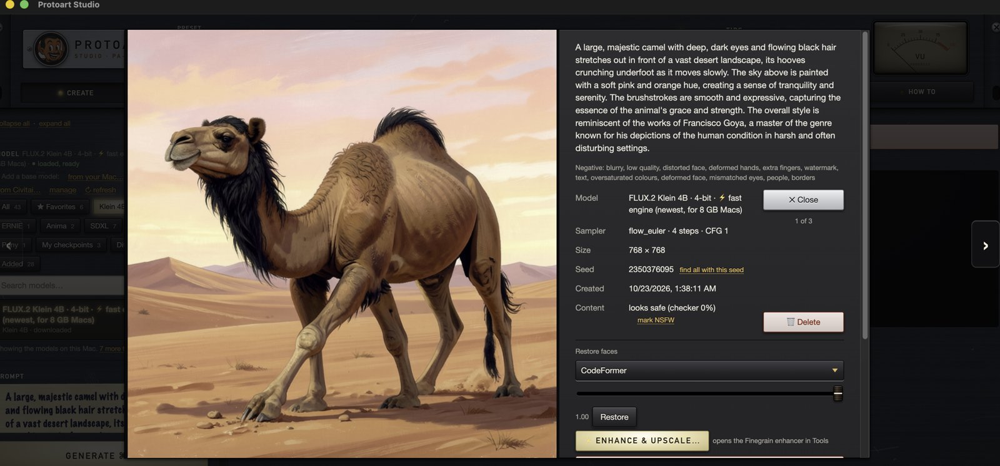

# Protoart Studio

A local AI image studio for Apple Silicon Macs, styled like vintage studio hardware. Everything runs on your Mac:
no account, no cloud, no telemetry. It is built on Hugging Face diffusers (PyTorch on the Apple GPU) plus Apple's
MLX for a faster engine, with an Electron + Vue window. The design idea (an Electron window talking to a Python
engine) comes from DiffusionBee; no DiffusionBee code is used.

> **Models are not included.** Protoart Studio ships no model weights. You download them from inside the app (from
> Hugging Face or Civitai) or use files you already have, and **each model has its own licence**, which you accept
> when you use it. See [Models and licences](#models-and-licences).

## Screenshots



| ✨ Edit with words: paint over the cat… | …and “make it a dog” changes just that |
|---|---|
|  |  |





## What it does

- **Create:** text to image with SD 1.5, SDXL (incl. Pony / Illustrious / NoobAI), Anima (anime; all-ages by default via its "safe" rating tag), ERNIE-Image, FLUX.1 Schnell, FLUX.2 Klein 4B
  (made for 8 GB Macs) and FLUX.1 Dev (32 GB+); LoRA stacking with per-LoRA weights (sort A–Z / newest first, filter by kind or ● People, ★ favourites, in Create and Image to image),
  embeddings, VAEs (Automatic picks the right one for each model; each model remembers your own pick; one-click recommended VAE), 20+ samplers with the top picks per model,
  presets, 📒 saved prompts, wildcards, a random-prompt generator that writes tags or sentences to suit the model, negative
  prompt ✨ suggest / 🎲 random matched to the model, ⚡ fast mode, live preview, a queue with ❚❚ Pause / Skip / Stop, and
  🔬 compare grids picked with keys, 🎲 small change (variation seed), 📒 saved prompts with export / import, ✨ enhance and 🔄 contrast prompts, and your own default sampler / steps / guidance per
  model and default weight per LoRA, 🗺 regional prompts (✨ plan the layout from one sentence), A1111-style prompt editing, 🧱 seamless tiling
  clips, and 📥 settings from A1111 / ComfyUI / InvokeAI pictures or .json
- **Image to image:** ✨ Edit with words (FLUX.2 Klein: describe a change; paint to limit it; add reference pictures),
  change / inpaint / expand (any picture, with FLUX.2 Klein + an outpaint LoRA) / 🩹 remove, selection tools (brush, lasso, polygon lasso, magic wand, object selection),
  ControlNet (canny, depth, lineart, scribble, soft edge, pose, tile, and your own SD 1.5 and SDXL ControlNets), image prompt
  (IP-Adapter), face detailer, CodeFormer presets, ControlNet Union ProMax for SDXL, 🔁 face swap (non-commercial,
  consent required), and a 🔗 model chain (SD 1.5 → SDXL → FLUX / ERNIE)
- **Tools** (rack modules): Finegrain enhance & upscale, face restoration (CodeFormer or RestoreFormer), 🩹 remove objects
  (paint right in Tools; smart or quick fill), ✒️ vectorize to SVG, image → prompt (Qwen3.5 vision model, Florence-2 or
  WD tagger), depth maps, 🎚 Adjust (Lightroom / Color Efex-style with ◎ control points, plus a Procreate-style Bloom), 🪡 Puppet warp, DiffusionBee file conversion, Original / Result /
  Split / Side-by-side views, and a 🔌 patchbay to run Remove, Faces, Enhance, Depth, Vectorize and 🔎 Detail (with a LoRA)
  in any order with cables (modules can be moved, added twice or taken off; each copy has its own settings; 🛡 paint areas
  it must not change; live preview), 🧩 tiled upscale (MultiDiffusion), 🗜 smaller 8 / 6 / 4-bit model copies, 🧪 model
  merger, `.ckpt` → `.safetensors` conversion, and model → LoRA extraction (drag files or folders onto Convert)
- **Right-click menus everywhere:** models (incl. ⟲ Reconnect… for a moved or missing file, and 💾 Keep a copy on this Mac for a model on an external drive, so it loads in seconds), LoRAs, the queue, your folders, pictures and text boxes
- **Library:** right-click menu; search by prompt, seed, model or LoRA; drag to select many; ⇆ compare side by side with linked zoom; stars; ↺ reuse a picture's prompt or settings; 🗑 delete (asks
  first); batch edit & export; 🗜 compress to the smallest file that still looks the same
- **Train:** LoRA training (SD 1.5 / SDXL; ERNIE on 32 GB+ Macs), embedding training (SD 1.5), square crop / keep-whole
  framing, and merging LoRAs of the same type into one
- **Models tab:** download models, add your own files or folders (removals locked and confirmed), Civitai downloads of
  LoRAs, checkpoints, embeddings, VAEs and SD 1.5 / SDXL ControlNets, Hugging Face downloads (sign-in keys kept only on your
  Mac), Embeddings / VAEs / ControlNets lists, ★ favourites, and "Fix a type" for mislabelled files
- **DiffusionBee import:** your DiffusionBee models, LoRAs and embeddings appear automatically (read in place)
- **Existing model libraries:** Stability Matrix, ComfyUI, Automatic1111 / Forge, InvokeAI and Fooocus libraries are
  detected and, if you say yes, used where they are (read-only: nothing is copied, moved or changed)
- **Content filter:** 🛡 Safe-for-work mode (refuses adult prompts, blocks and hides NSFW), Hide NSFW / Hide People,
  with your own ⚑ / ● marks
- **Comfort:** tips on every button (TIPS lever), 🔔 finish sounds, Light / Dark / Match macOS and four colour themes
  (Amber, Cream, Slate, Ember), Community & support links and a model licence table in How to

The app's **How to** tab is the full manual, including Troubleshooting and a Disclaimer & licences page.

## Community

- **Download:** [GitHub Releases](https://github.com/theprotoart/protoart-studio/releases/latest)
- **Hugging Face:** [huggingface.co/spaces/brushpenbob/protoart-studio](https://huggingface.co/spaces/brushpenbob/protoart-studio)
- **Discord:** [discord.gg/zRC6zrufYE](https://discord.gg/zRC6zrufYE) (news, help, and #ideas-and-feedback)
- **Civitai:** [theprotoartent677](https://civitai.com/user/theprotoartent677)
- **Bugs and ideas:** #ideas-and-feedback on Discord, or [GitHub Issues](https://github.com/theprotoart/protoart-studio/issues)

## Supported Macs

| | |
|---|---|
| Processor | **Apple Silicon only** (M1, M2, M3, M4 and newer). Intel Macs are not supported (see [Known limitations](#known-limitations)). |
| macOS | 13 Ventura or newer |
| Memory | 8 GB works (SD 1.5, SDXL in low-memory mode, ERNIE / FLUX on the fast engine); 16 GB+ is comfortable |
| Disk | ~2 GB for the app, plus 2–13 GB per model you download |

## Install the app

1. Download `Protoart-Studio-<version>.dmg` and `Protoart-Studio-<version>.dmg.sha256` from the
   [Releases](../../releases) page.
2. Optional but recommended: check the download. In Terminal:
   ```bash
   shasum -a 256 ~/Downloads/Protoart-Studio-<version>.dmg
   ```
   The result must match the line in the `.sha256` file exactly.
3. Open the DMG and drag **Protoart Studio** onto **Applications**.
4. First launch: test builds aren't signed with an Apple developer certificate, so macOS blocks the app the first
   time. Open **System Settings → Privacy & Security** and click **Open Anyway** (macOS 15+), or right-click the app →
   **Open** (older macOS). If macOS says the app is *damaged*, don't force it open: download it again and check the
   checksum.

## First steps

1. **Pick a model** in Create. Models on your Mac are listed there; the **Models** tab has more to download
   (each shows its size and the memory it needs). On an 8 GB Mac, good starters are *SD 1.5*,
   *ERNIE-Image Turbo · 4-bit · ⚡ fast engine*, *FLUX.2 Klein 4B · 4-bit · ⚡ fast engine* and
   *FLUX.1 Schnell · 3-bit · ⚡ fast engine*.
2. **Type a prompt** and press **Generate** (⌘↵). The first time, the model downloads (progress is shown), then it
   works offline.
3. Pictures land in the **Library** with their settings. Click one to reuse its prompt, enhance it, adjust it, export
   it, or send it to Image to image.

## Using your own models, LoRAs and embeddings

Nothing is copied: files are used where they are (an external drive is fine, as long as it's connected).

| What | How |
|---|---|
| Everything in one place | Settings → **Model folders → Main folder**: pick one folder (an external drive is fine); its *Models*, *LoRAs*, *Embeddings*, *VAE* and *ControlNet* sub-folders are used. **↻ Refresh** re-reads everything |
| Base model files (`.safetensors`, `.ckpt`, diffusers folders) | Models tab → **Your model files** → *Add model files or folders…*, or Settings → **Model folders** → *More model folders → Add folders…* (every model in it, including ones added later) |
| Old `.ckpt` models that won't load | Tools → **Convert → Old .ckpt files…** (or drag the file onto Convert): a `.safetensors` copy, read safely (nothing in the file is run; the `.ckpt` isn't changed) |
| LoRAs | Settings → **LoRA folders** → *Add LoRA folders…*; set a folder's type (SD 1.5 / SDXL / FLUX / ERNIE) or leave it on *Auto* |
| Embeddings | Settings → **Embeddings** → *Add embedding files…* / *Add folders…* |
| Downloads from Civitai / Hugging Face | Models tab → **Add from Civitai** / **Add from Hugging Face** (paste a link). Some need a free account: the app shows the steps |
| Where downloaded models are kept | Settings → **Model folders → Downloaded models folder** (default `~/.cache/huggingface/hub`; can be an external drive) |
| A file listed under the wrong type | Models tab → **Fix a type** |

### Where your data lives

| What | Where |
|---|---|
| Pictures | `~/.protoartstudio/images/<date>/` (change in Settings → Image storage) |
| Library, presets, settings | `~/.protoartstudio/library.sqlite` |
| LoRAs / checkpoints you put in the app's own folders | `~/.protoartstudio/loras/`, `~/.protoartstudio/models/` |
| Downloaded models | `~/.cache/huggingface/hub` (or the folder you chose) |
| Fast engine (MLX), installed on first use | `~/.protoartstudio/venv-mlx` (~1.5 GB) |

Civitai API keys and Hugging Face tokens you save in the app are stored only in the local library database and are
sent only to civitai.com / huggingface.co. See [PRIVACY.md](PRIVACY.md).

## Models and licences

Protoart Studio does not distribute model weights. Models download from their publishers (mostly Hugging Face) the
first time you use them, or you supply your own files. **Every model has its own licence and terms**, and some do not
allow commercial use, for example:

- SD 1.5, Juggernaut Reborn, ControlNet 1.1: CreativeML OpenRAIL-M · SDXL: CreativeML OpenRAIL++-M
- ERNIE-Image, FLUX.1 [schnell], IP-Adapter, Qwen2.5, WD tagger, Depth Anything V2 Small, Qwen3.5 4B: Apache-2.0 · Florence-2: MIT · mlx-vlm: MIT
- Xinsir ControlNet Union ProMax: Apache-2.0
- **Non-commercial:** the enhancer's 4x-UltraSharp upscaler (CC BY-NC-SA 4.0), Depth Anything V2 Base / Large
  (CC BY-NC 4.0), Anima / Anima Turbo (CircleStone Labs Non-Commercial; pictures may be used commercially), the face
  swap models inswapper_128 and ArcFace (InsightFace, non-commercial research only)
- Models and LoRAs from Civitai: whatever their author chose (shown on the model's page)

The full list is in [THIRD_PARTY_NOTICES.md](THIRD_PARTY_NOTICES.md). Check a model's own page for its current terms
before using results commercially. AI pictures can be inaccurate or contain unexpected content; you are responsible
for what you make and share.

## Known limitations

- **Apple Silicon only.** The engine needs PyTorch 2.6+, which has no Intel-Mac builds (PyTorch's last Intel-Mac
  release is 2.2), and the fast engine (MLX) runs only on Apple chips. An Intel build would lose ERNIE and FLUX and
  run on the CPU (minutes per picture), so none is offered.
- **Memory decides what runs.** On 8 GB Macs: SDXL needs low-memory mode, ERNIE / FLUX need the 3–4-bit fast-engine
  builds, embedding training is SD 1.5 only, ERNIE LoRA training needs 32 GB+. The Models tab marks what fits.
- **Unsigned test builds.** macOS asks you to allow the app the first time (see Install). The app is ad-hoc signed
  and not notarised.
- **First use of each model downloads it** (2–13 GB); after that it works offline.
- **DiffusionBee import:** SD 2.x, inpainting models and DiffusionBee's 8-bit SDXL files aren't supported.
- Draw Things' own model files (`.ckpt` in its SQLite format) aren't read; use the original model instead.
- No automatic updates: check the Releases page.

## Build from source

Needs an Apple Silicon Mac, macOS 13+, Python 3.10+ (3.12 recommended), Node.js 18+, Xcode command-line tools
(`xcode-select --install`), an internet connection and ~6 GB free.

```bash
git clone https://github.com/theprotoart/protoart-studio.git protoart-studio
cd protoart-studio
./setup.sh      # Python venv with the exact tested versions (backend/requirements.lock.txt) + Electron; runs the tests
./start.sh      # run the app from source
```

Tests (no GPU or models needed):

```bash
cd backend && .venv/bin/python -m unittest discover -s tests -t .
```

Build the standalone app and the DMG (after `setup.sh`):

```bash
bash packaging/build_mac_app.sh     # dist/Protoart Studio.app (bundles its own Python; ~1.8 GB)
bash packaging/make_dmg.sh          # dist/Protoart-Studio-<version>.dmg + .sha256 (rebuilds the app first)
```

The `.command` files at the top level do the same with a double-click. Release steps are in
[RELEASING.md](RELEASING.md).

### Layout

```
app/                Electron main process (main.js), preload bridge, renderer/ (Vue 3, no build step)
backend/            Python engine: bee_backend.py (JSON-lines protocol), engine.py (models, LoRAs, generation),
                    library.py (SQLite), trainer.py / ti_trainer.py / lora_merge.py (Train tab),
                    mlx_engine.py + mlx_worker.py (fast engine), postprocess/ (enhancer, faces, image → prompt),
                    tests/ (unit tests, no GPU needed)
packaging/          build_mac_app.sh, make_dmg.sh, DMG background
```

## Licence

The app's own code is open source under the **Apache License 2.0** ([LICENSE](LICENSE)). Code adapted from other
projects (MIT / Apache-2.0) and the software bundled in the built app are listed with their licences in
[THIRD_PARTY_NOTICES.md](THIRD_PARTY_NOTICES.md). Model weights are not part of this project and keep their own
licences.

## Privacy and security

Everything runs on your Mac. The app goes online only to download something you asked for (a model, a tool, the
fast engine), and **Settings → Privacy → Strict offline** blocks even that. See [PRIVACY.md](PRIVACY.md) and
[SECURITY.md](SECURITY.md) (please report vulnerabilities privately). Contributions: [CONTRIBUTING.md](CONTRIBUTING.md).
